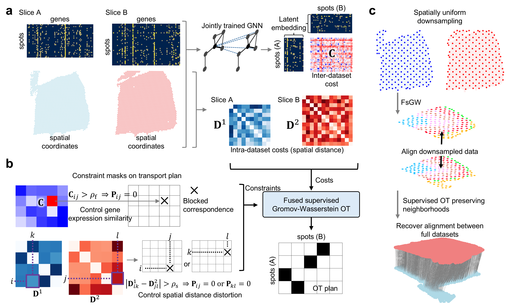

# RAFT-UP — revision branch

RAFT-UP aligns spatial transcriptomics data under partial overlap. This branch contains the revision package (`raftup`, version `0.2.0.dev0`), automatic/manual alignment entry points and experiment notebooks. `main` retains the original version.

## Start here

You need Git, Conda (or Miniforge) and internet access to install dependencies. Run these commands in a terminal; do not enter them into a notebook Python cell.

```sh
git clone --branch revision https://github.com/L1feiyu/raftup_repo.git
cd raftup_repo
conda env create -f environment.yml
conda activate raftup_revision
python -m pip install -e '.[revision]'
python -m pip check
python -m ipykernel install --user --name raftup_revision --display-name 'Python (raftup_revision)'
python scripts/execute_revision_notebooks.py --mode tutorials --notebook 00 \
  --output-dir outputs/smoke_check_01
```

The final command runs a small solver check without downloading any data. It writes an executed notebook and `result.json` under `outputs/smoke_check_01/00_installation_smoke_test/`. Use a new output directory when repeating the check. If an environment named `raftup_revision` already exists, activate that installation or choose a different environment name with `conda env create -n YOUR_ENV -f environment.yml`; then activate and register that environment under its own kernel name.

The environment was verified on macOS arm64 with CPU execution. Linux/CUDA is not yet verified. A GPU is not required for the saved-cost alignment and plotting examples. See [installation and execution instructions](examples/revision/README.md) and the precise [validation scope](examples/revision/VALIDATION.md).

## Choose what to run

| Goal | Entry point | Inputs |
|---|---|---|
| Check installation | [Notebook 00](examples/revision/00_installation_smoke_test.ipynb) | None; synthetic input is generated in memory |
| Run a new alignment or evaluation | [Tutorials 01–07](examples/revision/README.md) | Prepared slices, ordered feature costs and a pair/series manifest; audit 07 also needs a saved alignment |
| Redraw the five manuscript figures | [Figure notebooks](examples/revision/figures) | Authors' saved revision-result archive; original raw data alone are insufficient |
| Inspect original experiment protocols | [Historical protocol copies](examples/revision/protocol_sources) | Historical paths and environments; not the portable entry point |

[DATA.md](examples/revision/DATA.md) lists original-data downloads, the input format and preparation commands. New revision datasets and generated results are kept outside Git. Some older tutorial assets remain in the repository history. **The derived-result archive needed for the exact paper figures does not yet have a public download link in this repository.** The package-call tutorials and the archived-figure notebooks serve different purposes.

For interactive use, run `jupyter lab` from this repository and select **Python (raftup_revision)** in the notebook kernel menu. Begin with notebook 00, then follow the input checklist in the selected tutorial. The revision environment and the [legacy environment](environments/environment-legacy.yml) are separate configurations.

---

# Legacy tutorials and background

The material below describes the original workflows. Start with the revision notebooks linked above for the new experiments. Legacy notebooks may use different paths or environments and were not included in the revision execution checks.

RAFT-UP is a tool for robust spatial transcriptomics data alignment that infers overlap portion and provides explicit control over spatial distance
preservation. It provides tools for preprocessing, gene-cost construction, downsampling-based matching, full-resolution recovery, and visualization of alignment results.



## Basic usage

A typical workflow in RAFT-UP includes:

1. Preprocess the input slices and identify spatially variable genes using SOMDE.
2. Construct the gene cost matrix using spatial representation learning.
3. Compute the downsampled alignment.
4. Recover the full-resolution alignment.
5. Visualize and evaluate the matching results.

The original end-to-end tutorial is located at:
```bash
examples/DLPFC_tutorial/RAFTUP_end_to_end_pipeline.ipynb
```
For users with two prepared spatial transcriptomics .h5ad files, update the User configuration section of the notebook with the paths to the two AnnData objects.

For more detailed control of preprocessing, gene-cost construction, downsampled alignment, and full-resolution recovery, see:
```bash
0_somde_robust_scanpy.ipynb

1_DLPFC_gene_cost_by_somde.ipynb

2_alignment_step1_ds_turbo.ipynb

2_alignment_step2_rf.ipynb
```
More details and tutorials are available at https://raftup-repo.readthedocs.io/en/latest/.

## Key parameters

Some important parameters used in RAFT-UP include:

- `rho_f1`: gene-expression cutoff used in the downsampled alignment stage.
- `rho_s`: spatial distance cutoff used in the downsampled alignment stage.
- `rho_f2`: gene-expression cutoff used in the full-resolution recovery stage.
- `rho_t`: spatial distance cutoff used in the full-resolution recovery stage.
- `k1`, `k2`: nearest-neighbor parameters used for construction of spatial cost in the full-resolution recovery stage.

## Installation

### Main installation

RAFT-UP uses several scientific Python packages with version-sensitive dependencies.  

For a reproducible installation, we recommend creating the provided Conda environment.

Clone the repository:

```bash
git clone --branch revision https://github.com/L1feiyu/raftup_repo.git
cd raftup_repo
```

Create and activate the RAFT-UP environment:

```bash
conda env create -f environment.yml
conda activate raftup_revision
```

Install RAFT-UP from the cloned repository:

```bash
python -m pip install -e '.[revision]'
```

To verify the installation, run:

```bash
python -c "import raftup; print(raftup.__version__); print(raftup.__file__)"
```


### Optional Mayavi environment

For Mayavi-based 3D visualization of RAFT-UP alignment, we recommend using a separate environment to avoid dependency conflicts with the main RAFT-UP environment.

Create the Mayavi environment for RAFT-UP visualization with:

```bash
conda create -n mayavi_env -c conda-forge python=3.11 mayavi pyqt scanpy ipykernel openpyxl "numpy<2.4"
conda activate mayavi_env
```
